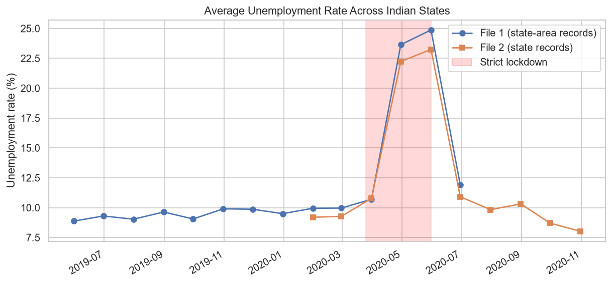
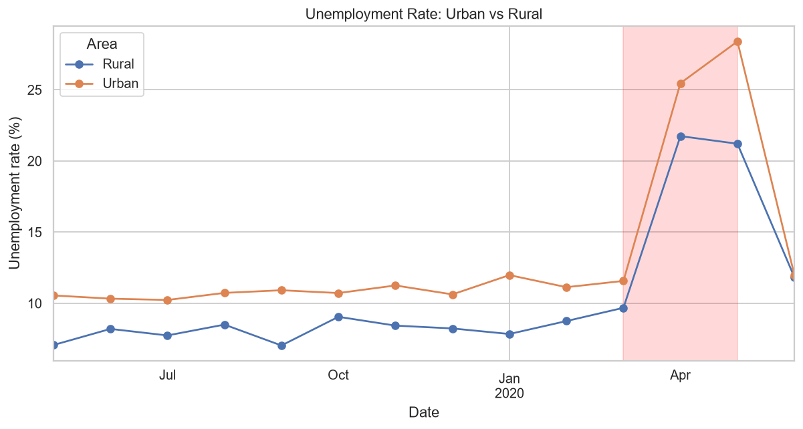

# Unemployment Analysis in India

An exploratory data analysis of unemployment trends in India, with a focus on the impact of the COVID-19 lockdown (March–May 2020). Built as part of the **CodeAlpha** internship program.

## Datasets

| File | Description |
|------|-------------|
| `Unemployment in India.csv` | State- and area-level (urban/rural) unemployment records from May 2019 to June 2020 |
| `Unemployment_Rate_upto_11_2020.csv` | State-level unemployment records with zone information from January to October 2020 |

Key columns include **Estimated Unemployment Rate (%)**, **Estimated Employed**, and **Estimated Labour Participation Rate (%)**.

## Analysis & Visualizations

The script [`unemploy.py`](unemploy.py) performs the following analyses and saves charts to the `charts/` folder:

1. **National Unemployment Trend** — Average unemployment rate over time across both datasets, with the strict lockdown period highlighted.
2. **Employment & Labour Participation** — Total estimated employed (millions) and average labour participation rate over time.
3. **Urban vs Rural** — Comparison of unemployment rates between urban and rural areas.
4. **Most Affected States** — Top 10 states with the largest rise in unemployment during the lockdown vs pre-lockdown period.
5. **Zone-wise Trends** — Unemployment rate by geographic zone throughout 2020.
6. **State × Month Heatmap** — Heatmap of unemployment rate by state and month for 2020.

## Sample Charts

| National Trend | Urban vs Rural |
|:-:|:-:|
|  |  |

## Requirements

- Python 3.8+
- pandas
- matplotlib
- seaborn

Install dependencies:

```bash
pip install pandas matplotlib seaborn
```

## Usage

```bash
python unemploy.py
```

Charts will be saved in the `charts/` directory, and summary statistics will be printed to the console.

## Key Findings

- Unemployment spiked dramatically during the COVID-19 lockdown (March–May 2020).
- Urban areas were hit harder than rural areas.
- Employment levels dropped significantly during the lockdown but showed signs of recovery by mid-2020.
- The dataset is too short to distinguish seasonal patterns from the COVID-19 shock.

## License

This project is for educational purposes as part of the CodeAlpha internship.

